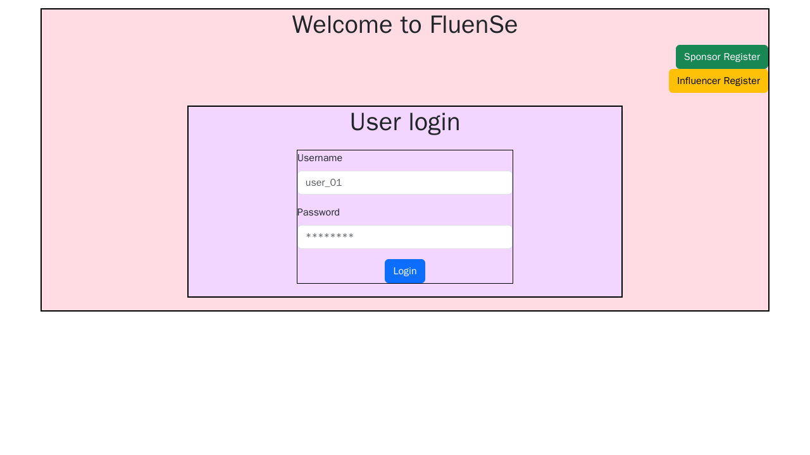

# Fluense

Fluense is a server-rendered Flask application for coordinating sponsorship campaigns between brands and social-media influencers. I built it as an Application Development I course project in the IIT Madras BS program.



## Product scope

The application models three roles:

- **Influencers** create a profile, describe their niche and platform presence, discover campaigns, and respond to sponsorship requests.
- **Sponsors** create campaigns, search for influencers, and manage ad requests and campaign budgets.
- **Administrators** inspect users and campaigns, flag records, and review summary charts.

The project demonstrates relational modelling with one-to-one and one-to-many relationships, role-specific Flask routes, Jinja templates, file uploads, SQLite persistence, and Matplotlib dashboards.

## Architecture

```text
browser
  -> Flask routes + session
      -> Jinja templates
      -> SQLAlchemy models -> SQLite
      -> Matplotlib charts -> static files
```

The implementation is preserved under `Project Mad1 Git/code/` to retain the original course-project layout.

## Run locally

Prerequisites: Python 3.10+.

```bash
cd "Project Mad1 Git/code"
python -m venv .venv
source .venv/bin/activate
pip install -r requirements.txt
python app.py
```

Open <http://127.0.0.1:5000>. On Windows, activate with `.venv\Scripts\activate`.

Configuration is supplied through environment variables:

| Variable | Default | Purpose |
| --- | --- | --- |
| `FLUENSE_SECRET_KEY` | random per process | Flask session signing; set a stable secret outside development |
| `FLUENSE_DATABASE_URL` | `sqlite:///fsdata.sqlite3` | SQLAlchemy database URL |
| `FLUENSE_PORT` | `5000` | HTTP port |
| `FLUENSE_DEBUG` | disabled | Enable Flask debug mode with `1`, `true`, or `yes` |

Copy `.env.example` as a reference; Flask does not automatically load that file in this legacy project.

## Password safety and legacy data

New registrations store Werkzeug password hashes. The checked-in course database may contain older plaintext credentials: after a successful legacy login, the application replaces that value with a hash in the same transaction. The migration exists only for compatibility with the original demo data.

For any public deployment, start with a fresh database, provide a strong `FLUENSE_SECRET_KEY`, add CSRF protection, enforce route-level authorization, and validate uploaded files beyond their extension.

## Docker

```bash
docker build -t fluense .
docker run --rm -p 5000:5000 -e FLUENSE_SECRET_KEY="replace-me" fluense
```

The container uses the bundled SQLite database by default. Mount a volume or set `FLUENSE_DATABASE_URL` if persistence is required.

## Tests

```bash
cd "Project Mad1 Git/code"
pytest -q
```

The included security tests cover new password hashing and migration-compatible verification.

## Current limitations

- This is a course prototype, not a production service.
- Several role-specific routes trust URL identifiers and need systematic authorization checks.
- Uploaded images are limited by extension, but content type and file size are not fully validated.
- SQLite and local static files are suitable for a single-process demo, not a scaled deployment.
- The original templates are desktop-oriented and have not been audited for accessibility.
